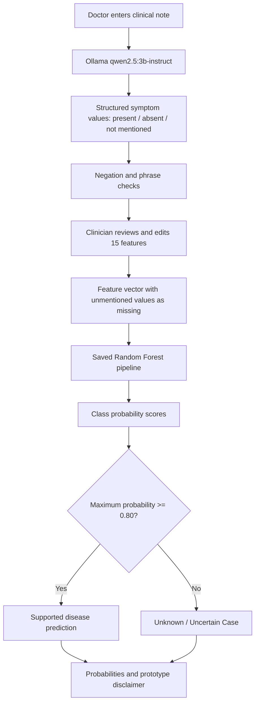

<div align="center">

# 🩺 FluAssist

**A clinician-assisted febrile disease classification prototype powered by a Random Forest model and a local small language model.**

[](https://www.python.org/)
[](https://streamlit.io/)
[](https://scikit-learn.org/)
[](https://ollama.com/)

</div>

FluAssist is an academic clinical decision-support prototype for reviewing clinical notes and classifying symptom patterns associated with **Chikungunya, Dengue, Malaria, and Typhoid**. It combines an Ollama-hosted language model for structured symptom extraction with a saved Random Forest pipeline and a probability threshold. A clinician can review and edit extracted findings before requesting a prediction.

> **Prototype only:** FluAssist is not a diagnostic device and must not be used to make healthcare decisions without qualified clinical assessment and appropriate confirmatory investigations.

## 📚 Table of Contents

- [Key Features](#-key-features)
- [System Architecture](#-system-architecture)
- [Technologies Used](#-technologies-used)
- [Project Structure](#-project-structure)
- [Installation and Setup](#-installation-and-setup)
- [Running the Application](#-running-the-application)
- [How It Works](#-how-it-works)
- [Machine Learning Model](#-machine-learning-model)
- [Explainable AI and NLP/SLM Integration](#-explainable-ai-and-nlpslm-integration)
- [Screenshots](#-screenshots)
- [Dataset Information](#-dataset-information)
- [Limitations](#-limitations)
- [Future Enhancements](#-future-enhancements)
- [Contributors](#-contributors)
- [Disclaimer](#-disclaimer)
- [License](#-license)

## ✨ Key Features

| Feature | What the repository implements |
| --- | --- |
| Clinical-note input | Streamlit text area for entering a doctor's clinical note. |
| Structured symptom extraction | Ollama `qwen2.5:3b-instruct` extracts 15 configured findings as present, absent, or not mentioned. |
| Negation safeguards | Explicit phrase checks can override the model extraction for supported symptom terms and negations. |
| Human review | The clinician can review and edit each finding before prediction. |
| Four-class classification | A saved Random Forest pipeline produces probabilities for the four supported febrile diseases. |
| Probability-based abstention | The app accepts the leading class only when its probability reaches the configured `0.80` threshold; otherwise it returns “Unknown / Uncertain Case.” |
| Result transparency | Shows each class probability, the maximum probability, threshold, model label, and feature count. |
| Case reset | “New Case / Clear” resets the note and current extraction/prediction state. |

## 🏗️ System Architecture



The Streamlit entry point is `app/streamlit_app.py`. At startup it loads the version 2 model artifact, matching feature-column pickle, and `models/model_config_v2.json`. The SLM is used to extract findings from the note; the Random Forest pipeline—not the SLM—performs disease classification. The configured threshold determines whether the app displays the leading class as an accepted prediction or abstains.

## 🧰 Technologies Used

| Technology | Role in this repository |
| --- | --- |
| Python | Application and notebook language. |
| Streamlit | Web interface and interactive clinician review workflow. |
| scikit-learn | Random Forest classifier/pipeline and model probability prediction. |
| Ollama | Local model runtime accessed through the Python `ollama` client. |
| `qwen2.5:3b-instruct` | Model name configured for extracting findings from clinical notes. |
| pandas, NumPy | Feature-table construction, data handling, and missing-value representation. |
| joblib | Loading serialized model and feature-column artifacts. |
| Jupyter Notebook | Dataset analysis and model-training exploration. |
| CSV and Excel | Repository dataset formats. |

There is currently **no dependency manifest** (`requirements.txt`, `pyproject.toml`, or equivalent) in the repository. The Python package list in the setup below is based on imports in the application and training notebook; package versions are not pinned.

## 🗂️ Project Structure

```text
fluassist/
├── app/
│   ├── streamlit_app.py                    # Main Streamlit application
│   └── test_streamlit.py                   # Minimal Streamlit smoke-test page
├── datasets/
│   ├── Synthetic and Encoded Database of Dengue, Zika, Chikungunya, and Influenza Derived from the Literature.xlsx
│   ├── combined_febrile_dataset_v2.csv      # Dataset named in the active model config
│   ├── malaria_dataset.csv
│   ├── typhoid_dataset.csv
│   └── unified_febrile_disease_dataset.csv
├── models/
│   ├── backup/                              # Earlier model and feature artifacts
│   ├── febrile_random_forest_demo.pkl
│   ├── febrile_random_forest_v2.pkl         # Model loaded by the application
│   ├── feature_columns.pkl
│   ├── feature_columns_v2.pkl               # Feature columns loaded by the application
│   └── model_config_v2.json                 # Feature/disease names and 0.80 threshold
├── notebooks/
│   ├── 01_dataset_analysis.ipynb
│   ├── 02_train_random_forest.ipynb
│   ├── 03_merge_and_retrain_v2.ipynb        # Empty notebook in the current repository
│   └── 04_slm_extraction.ipynb              # Empty notebook in the current repository
└── FluAssist_Step_by_Step_Implementation_Guide.pdf
```

The repository also has a top-level `.DS_Store` file, omitted above as operating-system metadata. The `models/backup/` directory contains earlier/versioned pickle artifacts not loaded by the current application.

## ⚙️ Installation and Setup

### Prerequisites

- Python 3 and `pip`.
- [Ollama](https://ollama.com/download) installed and available on your system. The application requires an Ollama service and the configured model to perform note extraction.
- Git to clone the repository.

The repository does not specify a tested Python version or pinned package versions. Use a Python 3 environment compatible with the packages below.

### 1. Clone the repository and create a virtual environment

```bash
git clone https://github.com/vishnupg-git/fluassist.git
cd fluassist
python -m venv .venv
```

Activate it:

```bash
# macOS / Linux
source .venv/bin/activate

# Windows PowerShell
.venv\Scripts\Activate.ps1
```

### 2. Install the application dependencies

Run from the repository root:

```bash
python -m pip install --upgrade pip
python -m pip install streamlit ollama joblib numpy pandas scikit-learn
```

### 3. Prepare the local SLM

Make sure Ollama is running, then download the model name used by the app:

```bash
ollama pull qwen2.5:3b-instruct
```

If Ollama is not already running as a background service, start it in a separate terminal:

```bash
ollama serve
```

The app calls Ollama through its local Python client; it does not call a hosted API. No API key or application environment variable is defined in the repository.

## ▶️ Running the Application

From the repository root, with the virtual environment active and Ollama running:

```bash
streamlit run app/streamlit_app.py
```

Streamlit prints a local URL in the terminal (typically `http://localhost:8501`). Open that URL in a browser. The app expects the model and feature artifacts under `models/` and reads the probability threshold from `models/model_config_v2.json`; these artifacts are already included in the repository.

## 🩺 How It Works

1. **Enter a clinical note.** The app's text area is labelled for a doctor's clinical note.
2. **Extract symptoms.** On **Extract Clinical Features**, the app sends the note and the configured 15 feature names to the local Ollama model. A JSON schema constrains each output to `1`, `0`, or `null`.
3. **Apply text checks.** Explicitly supported negation phrases are set to absent; supported positive symptom phrases become present. Features without textual evidence are set to `null` (not mentioned), rather than assumed absent.
4. **Review and edit.** The app presents each extracted feature as **Not mentioned**, **Present**, or **Absent**. The clinician can change the values.
5. **Predict.** On **Confirm Features and Predict**, the app builds a feature row in the saved feature-column order and calls `predict_proba` on the loaded model pipeline. “Not mentioned” values are passed as missing (`NaN`).
6. **Apply the threshold.** The highest probability is compared with `0.80` from `model_config_v2.json`. At or above the threshold, the leading disease is shown as a supported prediction; below it, the app returns **Unknown / Uncertain Case**.
7. **Review output.** The result view shows class probabilities and a disclaimer that the prototype does not replace clinical judgment or confirmatory investigation.

## 🌲 Machine Learning Model

The active application loads `models/febrile_random_forest_v2.pkl` with joblib. The UI identifies it as **Random Forest V2 Balanced**; `model_config_v2.json` labels the version `RF_V2_Balanced`, lists 15 symptom features, four disease classes, and a probability threshold of `0.8`. The app accesses the classifier within a saved scikit-learn pipeline and uses its `predict_proba` output.

The training notebook `notebooks/02_train_random_forest.ipynb` documents an earlier training workflow using `unified_febrile_disease_dataset.csv`: it removes duplicate rows, makes a stratified 80/20 split, and trains a `RandomForestClassifier` with 300 estimators, `class_weight="balanced"`, `random_state=42`, and `n_jobs=-1`. That notebook's recorded evaluation belongs to that notebook's training run; it should **not** be treated as a verified performance result for the active version 2 artifact. The current app config points instead to `combined_febrile_dataset_v2.csv`, and the repository's v2 retraining notebook is empty, so the exact v2 training/evaluation procedure and its validation metrics are not documented here.

The displayed class probability is used as the app's decision score. The repository does not document calibration of those probabilities or establish the threshold as a clinically validated measure of certainty.

## 🔎 Explainable AI and NLP/SLM Integration

### NLP and SLM: implemented extraction workflow

The application sends the entered note to Ollama using model `qwen2.5:3b-instruct`. Its prompt explicitly instructs the model to extract only stated findings, avoid diagnosis or symptom inference, and mark unmentioned values as `null`. The generated structured output is schema-constrained. The app then applies phrase-based positive and negation checks (`FEATURE_TERMS` and `NEGATION_PATTERNS`) and gives a clinician an opportunity to correct the resulting values.

### Explainability: current scope

The application exposes the class probability table and the findings used as model input, which helps a reviewer see the input and output. However, the source does **not** implement feature attribution such as SHAP, LIME, feature-importance explanations for an individual case, or a clinical explanation of why a particular prediction was made. The SLM's role in the current application is symptom extraction; it does not generate a narrative explanation of the prediction. These forms of explainability would be future work, not current features.

## 🖼️ Screenshots

No application screenshots are included in the repository. Add captures in this section when available:

- **Clinical note and extraction:** `[Screenshot placeholder — add image of the note-entry and extracted-features review screen]`
- **Prediction results:** `[Screenshot placeholder — add image of the result and class-probability table]`

## 📊 Dataset Information

The repository includes several datasets. The active model configuration identifies **`datasets/combined_febrile_dataset_v2.csv`** as its dataset. The CSV schema visible in the repository has 15 symptom-feature columns and a `Disease` label, with disease labels for Chikungunya, Dengue, Malaria, and Typhoid. The individual feature values use binary-style `0`/`1` values, with some source CSVs also containing blank cells.

`datasets/unified_febrile_disease_dataset.csv` has the same 15 symptom fields plus the target label. The analysis notebook reports 2,203 rows, 1,071 unique rows after deduplication (1,132 duplicate rows), and an imbalanced label distribution in that file. Those counts describe the unified dataset analyzed in the notebook—not necessarily the active combined v2 dataset. The repository also contains `malaria_dataset.csv`, `typhoid_dataset.csv`, and an Excel workbook whose filename refers to Dengue, Zika, Chikungunya, and Influenza. The source does not document full provenance, licensing, or a reproducible procedure connecting each raw/source dataset to the current v2 model dataset. The workbook's filename includes diseases not in the active model's four classes; the active model configuration supports only the four classes listed above.

## ⚠️ Limitations

- The application is explicitly a prototype and is not a substitute for medical diagnosis, professional judgment, or confirmatory testing.
- Only four disease classes and 15 configured symptoms are represented; other conditions and symptoms are outside the configured classifier scope.
- The source dataset analysis documents duplicates, class imbalance, and symptom patterns shared across labels. The active v2 dataset's detailed composition and clinical representativeness are not established in the repository.
- Symptom extraction relies on a particular local SLM prompt plus phrase/negation matching. Wording, context, negation scope, typos, and language variation can affect extraction; clinician review is therefore part of the workflow.
- “Not mentioned” is sent to the model as a missing value. The app depends on the loaded pipeline to accept the resulting feature row; no separate validation of missing-input behavior is shown in the UI code.
- The `0.80` probability threshold is configured in the project, but no clinical validation or probability calibration is documented.
- The repository does not include pinned Python dependencies, automated application tests, or documented version 2 model evaluation metrics. `app/test_streamlit.py` is a minimal Streamlit smoke-test page, not a model or clinical validation suite.
- The application sends clinical-note text to the locally running Ollama instance. Do not enter real patient information unless the deployment has appropriate privacy, security, and governance controls.

## 🚀 Future Enhancements

- Add a pinned dependency file and document tested Python/Ollama versions and setup troubleshooting.
- Document data provenance, dataset versions, preprocessing, deduplication, and a reproducible version 2 training pipeline.
- Add independent validation, class-wise metrics, calibration analysis, and clinical review before considering any real-world use.
- Add automated tests for feature extraction, negation/context cases, model input ordering, threshold behavior, and application flow.
- Explore validated local feature-attribution methods and present explanations clearly as model behavior—not clinical rationale.
- Expand supported findings and disease classes only with appropriate, reviewed data and evaluation.
- Improve extraction handling for negation scope, temporal context, synonyms, and non-English notes, with clinician confirmation retained.

## 👥 Contributors

The GitHub contributor listing for this repository includes [yed-uoo](https://github.com/yed-uoo). No additional contributor acknowledgments are included because they are not established by the repository files inspected here.

## ⚕️ Disclaimer

FluAssist is an **academic software project and research prototype**. It is not intended for diagnosis, treatment, triage, or other clinical decisions and has not been established as safe or effective for clinical use. Its outputs may be incomplete or incorrect. Always consult a qualified healthcare professional and follow appropriate diagnostic procedures; do not delay or disregard professional care based on this application.

## 📄 License

No license file or license metadata was found in the repository. Unless the project owner adds a license, reuse and redistribution permissions are not specified.
